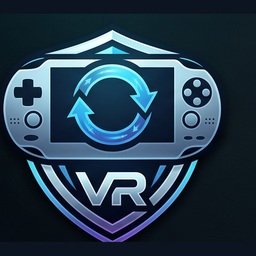
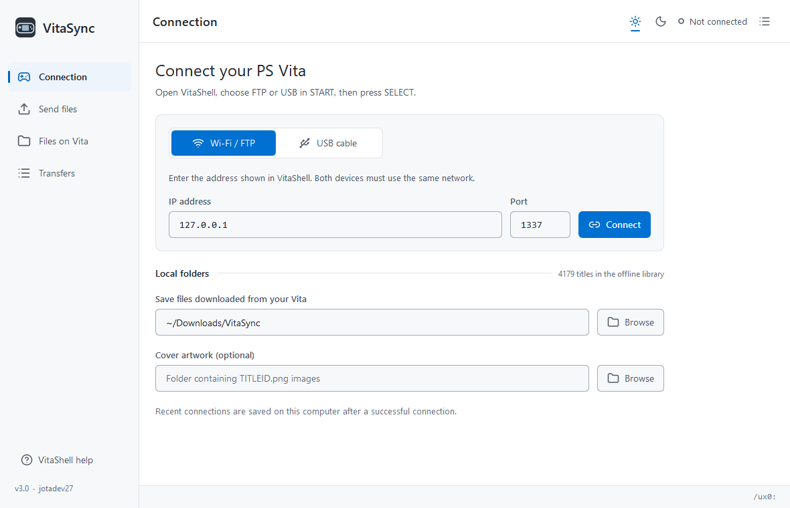
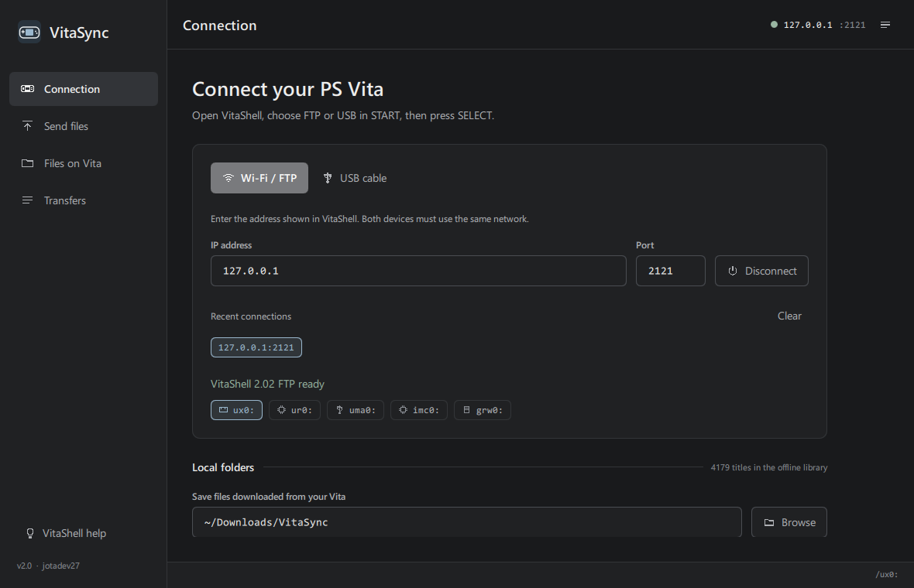
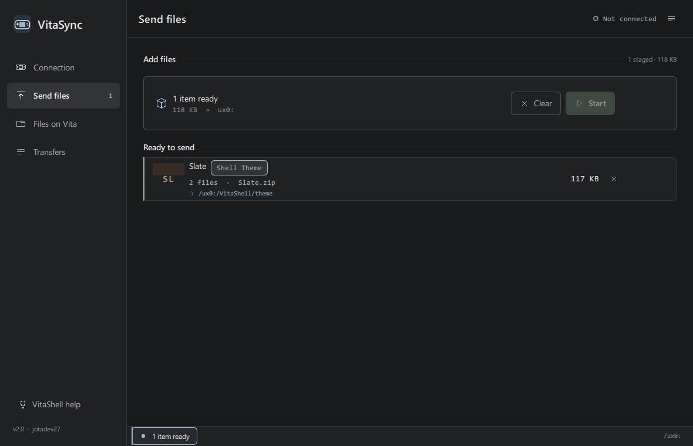
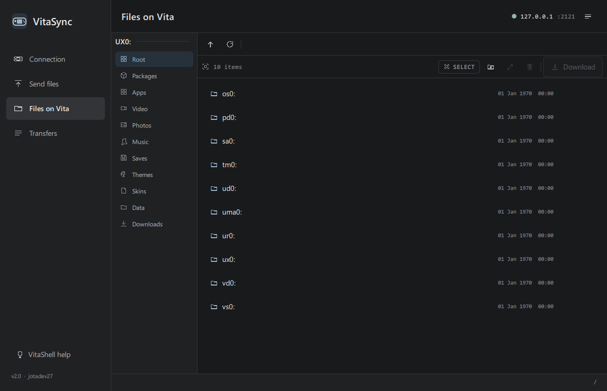
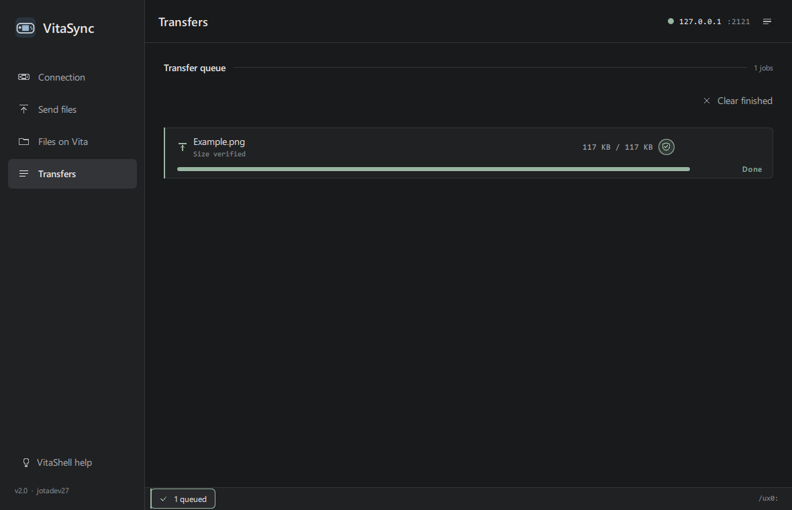

<p align="center">
  
</p>
<h1 align="center">VitaSync</h1>
<p align="center">Transfer files between your PC and PS Vita over FTP or USB.</p>
<p align="center"><strong>Version 2.0 · Windows 10/11 (64-bit)</strong></p>

VitaSync is a desktop companion for a homebrew-enabled PS Vita running
[VitaShell](https://github.com/TheOfficialFloW/VitaShell). Send games, media
and themes, browse storage, and download files to your PC. It works locally,
without an account or cloud service.

<p align="center">
  
</p>

## Download and run on Windows

Get the Windows packages from [GitHub Releases](https://github.com/jotadev27/VitaSync/releases).

- **Installer:** run `VitaSync-2.0-Windows-x64-Setup.exe`. It installs the app,
  creates desktop and Start menu shortcuts, and provides an uninstaller.
- **Portable:** extract `VitaSync-2.0-Windows-x64-Portable.zip` completely,
  then open `VitaSync/vitasync.exe`. Keep the bundled libraries and folders
  beside the executable. No Qt installation or PATH changes are needed.
- **Checksums:** compare the file's SHA-256 with `SHA256SUMS.txt`.

```powershell
Get-FileHash .\VitaSync-2.0-Windows-x64-Setup.exe -Algorithm SHA256
```

Windows 10/11 x64 is the package target. Linux source builds are supported;
Android scaffolding is experimental and is not included in this release.
The Windows binaries are not code-signed.

## What's new in 2.0

- A calmer graphite interface, clearer navigation, and simpler forms.
- Background USB detection, automatic selection of a single matching drive,
  storage-layout checks, and Windows USB device identification.
- A manual drive picker when automatic detection misses a mounted card.
- Windows USB copy fixes and a mount picker limited to the exported `ux0:`.
- Recent successful FTP connections that restore both address and port.
  History stays in the user's configuration, outside the project.
- The original transparent desktop/taskbar logo, with a separate interface icon.
- Windows-compatible test fixtures and regression coverage for history,
  USB scanning, hotplug selection, and transport switching.

## Connect your Vita

You need VitaShell and either a USB data cable or a PC on the same Wi-Fi
network as your Vita. Select one connection mode at a time.

### Wi-Fi / FTP

1. In VitaShell, press **START** and set **SELECT button** to **FTP**.
2. Close the menu and press **SELECT** to start the FTP server.
3. In VitaSync's **Connection** page, select **Wi-Fi / FTP**, enter the
   address and port displayed by VitaShell, and press **Connect**.

Successful endpoints appear under **Recent connections**. Selecting one
restores both fields; **Clear** removes the history. Failed connections are
not remembered. A fresh configuration defaults to `127.0.0.1:1337`.
Settings live in the user's application configuration directory, not in the
repository, installer, or portable folder.

<p align="center">
  
</p>

### USB cable

1. Connect the Vita using a USB data cable.
2. In VitaShell, press **START**, set **SELECT button** to **USB**, choose
   your storage device, close the menu, and press **SELECT**.
3. In VitaSync, select **USB cable**. Drives are scanned in the background
   about once per second while disconnected.
4. A single matching drive is selected automatically. Press **Connect USB**.
   With several candidates, choose the correct drive.
5. If Windows File Explorer shows the drive but it is not detected, use
   **Select drive manually**. If Windows cannot see it either, check the
   cable and VitaShell's selected USB device.
6. Finish transfers and safely eject the drive before unplugging it.

USB exposes one storage device as `ux0:`. Use FTP for other partitions.
See [USB behavior and detection](docs/usb.md) for details. Automated tests
use local storage fixtures; physical device identification and abrupt-unplug
write durability remain hardware checks.

## Send files, games, and themes

Drop files onto **Send files**, review their destinations, and start the transfer.

- **VPK packages:** upload and verify the reported size, then open the VPK
  in VitaShell and press **X**. Uploading alone does not install the package.
- **Unpacked game folders:** copy serial-named folders, then use VitaShell's
  **Refresh LiveArea** to make the console discover them.
- **Folder dumps:** `app/`, `addcont/`, and `license/` content goes to the
  corresponding locations. `.pkg` files are not supported.
- **Photos, music, and videos:** supported files go to their media folders.
- **Custom Vita themes:** send a folder containing `theme.xml`, then apply
  it with Custom Themes Manager on the console.
- **VitaShell skins:** send the skin, then select it in VitaShell's settings.
  VitaSync does not change the active skin automatically.

<p align="center">
  
</p>

## Browse and download

**Files on Vita** lets you browse, create folders, rename, move, delete, and
download files or whole folders. FTP shows the console's exposed partitions;
USB shows the exported `ux0:` drive. Multi-select and drag-and-drop are
supported. **Transfers** shows progress and the verification result.

<p align="center">
  
</p>
<p align="center">
  
</p>

Documentation screenshots use generated fixtures and a loopback FTP server.
They do not contain files copied from a personal Vita.

## Build from source

Requirements: CMake 3.21+, a C++17 compiler, Qt 6.5+ (Core, Gui, Network,
Concurrent, Quick, QuickControls2, Svg, and Test when enabled), and zlib.
Qt Multimedia is optional; without it, videos use a placeholder preview.
Match the compiler to the Qt kit; the Windows release uses Qt 6.8.3 and MinGW.

With a matching Qt kit, compiler, CMake, and Ninja in your terminal:

```sh
cmake -S . -B build -G Ninja -DCMAKE_BUILD_TYPE=Release -DCMAKE_PREFIX_PATH=/path/to/Qt
cmake --build build --parallel
ctest --test-dir build --output-on-failure
```

On Windows, run `build/vitasync.exe` with the Qt and compiler runtime folders
in PATH, or deploy a standalone package. On Linux, run `build/desktop/vitasync`.

### Windows packaging

After building a Release binary, run:

```powershell
.\tools\package_windows.ps1 -BuildDir build `
  -QtDir C:\Qt\6.8.3\mingw_64 `
  -MinGWDir C:\Qt\Tools\mingw1310_64 `
  -NsisExe 'C:\Program Files (x86)\NSIS\makensis.exe'
```

The script creates the installer, portable ZIP, checksums, and English release
notes under `installer/`. That entire folder is ignored by Git. Publish the
four files as GitHub Release assets rather than adding them to the repository.
Linux packaging scripts are also available under `tools/`.

### Tests and local development

Four suites cover parsing/path validation (`core`), FTP against an in-process
mock (`transport`), mounted-folder USB operations (`usb`), and application
integration (`device`). They do not replace testing with a physical Vita.

For the Windows 2.0 build, the first three suites and 42 integration cases
run separately passed. The FTP reconnect stress case stalled locally and
remains unresolved; the complete integration suite is not recorded as passing.

The mock server can also drive the GUI without a console:

```sh
mockvita --port 2121 /path/to/generated-card
vitasync --connect 127.0.0.1:2121
```

Useful flags include `--usb`, `--view browse`, `--log`, and
`--screenshot output.png`. Logs can contain addresses and file paths; keep them local.

## Privacy and transfer safety

- No telemetry, account, cloud sync, or automatic update checks.
- Addresses, ports, and folder preferences stay in local user settings.
  They are not embedded in release packages.
- FTP is unencrypted. Use a trusted local network and stop VitaShell's
  server after the session.
- Path validation, filename sanitization, and archive traversal checks guard
  file operations. Review destinations before transferring or deleting files.
- A local SHA-256 identifies uploads; remote verification checks the size
  reported by the device. This is not a remote checksum comparison.
- Transfer one item at a time and safely eject USB storage after completion.

## Project layout

| Folder | Contents |
| --- | --- |
| `core/vsp/` | Transports, routing, archive handling, browsing, transfer queue |
| `core/tests/` | Tests and mock VitaShell server |
| `desktop/qml/` | Desktop interface and components |
| `media/` | Media and theme previews |
| `assets/` | Public icons and offline title metadata |
| `tools/` | Build and packaging scripts |
| `docs/` | Implementation notes and sample screenshots |
| `installer/` | Local release artifacts, excluded from Git |

Maintained by [jotadev27](https://github.com/jotadev27).
